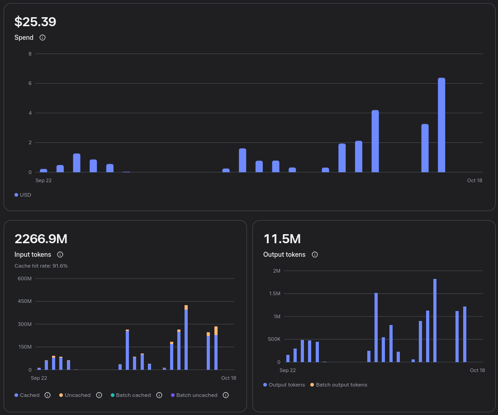
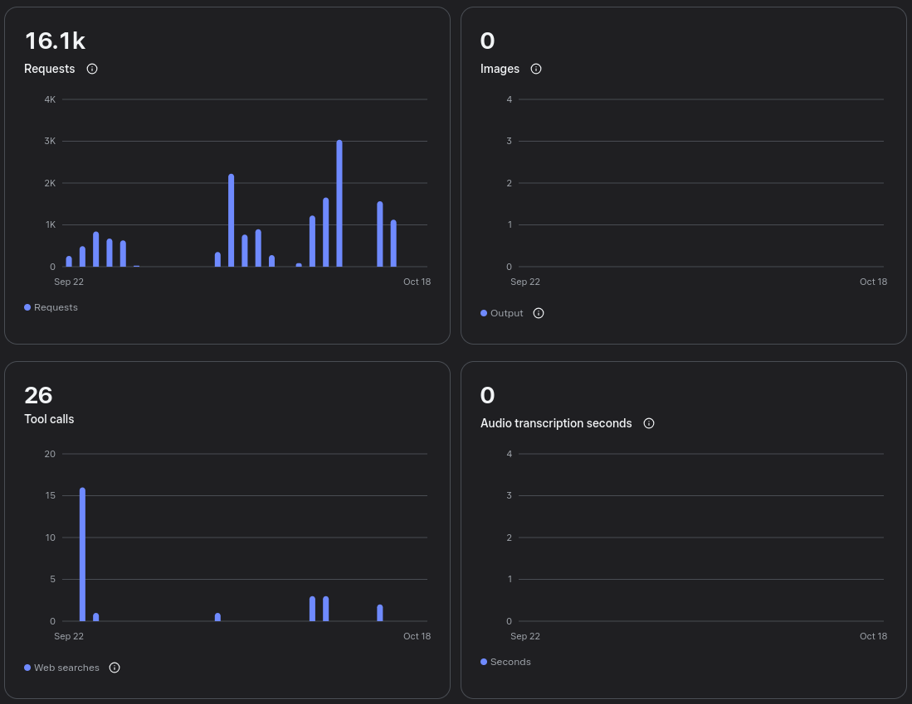
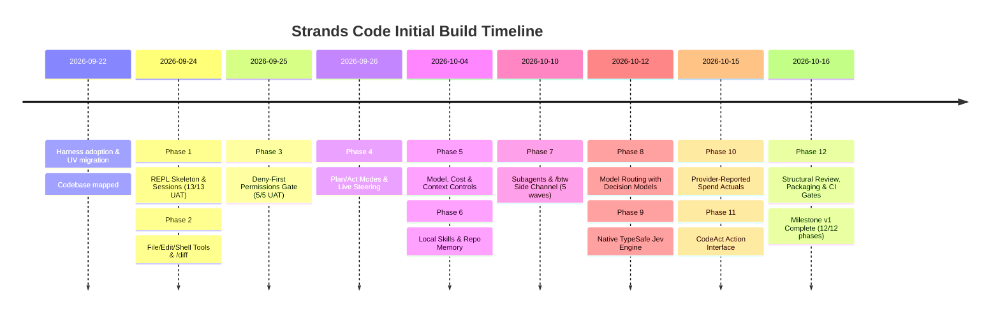

# Strands Code Initial Build Retrospective: 12 Phases, 2.27 Billion Tokens, $25.39

> **Project:** Strands Code (`strands-code`)  
> **Initial Build Milestone:** v1 (Phases 1–12, 41 execution plans)  
> **Development Period:** September 22, 2026 – October 16, 2026  
> **Methodology:** GSD (Git Ship Done) Spec-Driven Development (SDD)  
> **Agent Harness & Model:** Muse Code harness powered by the **Muse Spark 1.3 contributor model**  
> **Model Pricing (per 1M tokens):** Input: \$0.10 | Cached Input: \$0.002 | Output: \$0.20  

---

## 1. Executive Summary & Headline Numbers

Over 25 calendar days (comprising roughly 14 intense sprint days), the initial build of **Strands Code** progressed from a bare agent library fork (`aws-samples/sample-strands-code-agent`) into a feature-complete, production-grade conversational coding CLI. 

The entire initial build was driven autonomously through the **Muse Code harness** executing tasks with the **Muse Spark 1.3 contributor model**, governed end-to-end by the **GSD (Git Ship Done) Spec-Driven Development** methodology.

| Metric | Value | Context & Significance |
| :--- | :--- | :--- |
| **Total Cloud API Spend** | **\$25.39** | Entire build cost from project initialization to milestone close |
| **Total Input Tokens** | **2,266.9 Million** (~2.27 Billion) | Massive context volume across plans, verifications, and test suites |
| **Prompt Cache Hit Rate** | **91.6%** | Critical economic lever; kept 2.27B tokens under \$20 in input costs |
| **Total Output Tokens** | **11.5 Million** | Code generations, refactors, test suites, and planning docs |
| **Total API Requests** | **16.1k requests** | Average of ~390 requests per executed plan |
| **Tool Calls (Web Search)**| **26 searches** | Concentrated during initial research and decision API calibration |
| **Shipped Phases** | **12 / 12 completed** | 100% of planned milestone scope verified and closed |
| **Execution Plans** | **41 plans completed** | Decomposed into phased dependency waves |
| **Git Commits** | **516 commits** | Clean atomic commits with structured conventional messages |
| **Codebase Volume** | **40,840 lines** | Python source and tests across `strands_code_cli` and `tests` |
| **Automated Test Suite**| **1,549 tests** | Unit tests, contract suites, and end-to-end PTY/tmux rig scenarios |
| **Average Cost / Phase** | **\$2.11** | Full phase lifecycle: context, spec, plan, code, review, UAT, security |

---

## 2. API Economics & Telemetry Analysis

The Meta API console telemetry captured across the September 22 – October 18 period illustrates how modern prompt caching fundamentally reshapes the economics of autonomous software engineering.

### Console Telemetry Overview


*Figure 1: Spend (\$25.39 total), Input Tokens (2,266.9M, 91.6% cache hit rate), and Output Tokens (11.5M).*


*Figure 2: API Requests (16.1k total) and Tool Calls (26 web searches).*

### The Mathematical Breakdown of the \$25.39 Spend

At standard, uncached token pricing, feeding 2.27 billion tokens to an LLM would cost **\$226.69** on input alone. With Muse Spark 1.3's pricing structure:
- **Cached Input rate:** \$0.002 / 1M tokens (a 50× discount over uncached)
- **Uncached Input rate:** \$0.10 / 1M tokens
- **Output rate:** \$0.20 / 1M tokens

```text
Cached Input:    2,266.9M tokens × 91.6% = ~2,076.5M tokens @ $0.002/1M =  $4.15
Uncached Input:  2,266.9M tokens ×  8.4% =   ~190.4M tokens @ $0.10/1M  = $19.04
Output Tokens:      11.5M tokens          @ $0.20/1M                    =  $2.30
---------------------------------------------------------------------------------
Calculated Total:                                                         $25.49 (~$25.39 actual)
```

The GSD methodology's document-driven structure (holding persistent context files like `PROJECT.md`, `ROADMAP.md`, `STATE.md`, `CONVENTIONS.md`, and architectural summaries) created an ideal caching profile. The 91.6% cache hit rate meant that massive project contexts could be re-ingested repeatedly on every tool call and test evaluation without compounding API bills.

---

## 3. Methodology: GSD (Git Ship Done) Spec-Driven Development

The high success rate of the build without human intervention was made possible by adhering to **GSD Spec-Driven Development (SDD)**:

```mermaid
flowchart LR
    A["Context & Research<br/>(CONTEXT / RESEARCH)"] --> B["Spec & Requirements<br/>(AI-SPEC / REQS)"]
    B --> C["Wave Plans<br/>(XX-01..NN-PLAN)"]
    C --> D["Atomic Implementation<br/>(Code & Tests)"]
    D --> E["Code Review<br/>(REVIEW & FIX)"]
    E --> F["UAT & Verification<br/>(VERIFICATION / uattest)"]
    F --> G["Security Audit<br/>(SECURITY: 0 threats)"]
    G --> H["Nyquist Validation<br/>(VALIDATION: 0 gaps)"]
```



### The 7-Step Lifecycle of Every Phase

1. **Context Gathering & Discussion (`XX-CONTEXT.md`, `XX-DISCUSSION-LOG.md`):** Defining strict phase boundaries, out-of-scope fences, locked decisions, and reversibility assessments.
2. **Deep Technical Research (`XX-RESEARCH.md`):** Empirical catalog verification, API boundary probes (e.g. OpenRouter decision limits, Ollama local capabilities), and architectural spikes.
3. **Formal Specification (`AI-SPEC.md`, `REQUIREMENTS.md`):** Concrete requirements with traceability IDs (`LOOP-01`, `TOOL-03`, `MODEL-05`, etc.).
4. **Wave-Based Execution Planning (`XX-NN-PLAN.md`):** Splitting tasks into tracer slices, parallel waves, and gap-closure plans, each with explicit automated verify commands.
5. **Code Review & Automated Fixes (`XX-REVIEW.md`, `XX-REVIEW-FIX.md`):** Pre-merge analysis of every diff checking for logic errors, regressions, edge cases, and documentation drift.
6. **Live Verification & UAT (`XX-VERIFICATION.md`, `XX-UAT.md`):** Executing automated integration contracts and real terminal interactions via the `scripts/uattest/` headless PTY/tmux harness.
7. **Security Threat Audits & Nyquist Validation (`XX-SECURITY.md`, `XX-VALIDATION.md`):** Verifying STRIDE threat models (0 open actionable threats) and auditing test coverage density against Nyquist sampling criteria before closing the phase.

### Enforcement Gates
Quality was enforced through strict automated checks:
- **Radon & Xenon Cyclomatic Complexity:** Hard ceiling on absolute complexity (`--max-absolute C`); no overgrown spaghetti functions permitted.
- **Import Linter:** Architectural boundary contracts preventing composition-root circular imports or layer leaks.
- **Ruff:** 100% compliant formatting and linting.

---

## 4. Timeline, Build Streaks & Commit Velocity

The 516 commits between September 22 and October 16 clustered into four major high-intensity build streaks, perfectly mirroring the cost and request spikes in the Meta API telemetry:

```
Commits by Day:
Sep 22:   2  |
Sep 23:  16  |===
Sep 24:  33  |=======
Sep 25:  18  |====
Sep 26:  14  |===
  [Sep 27 - Oct 2: lull / planning]
Oct 03:   9  |==
Oct 04:  66  |==============  (Streak 2 Peak)
Oct 05:   7  |==
Oct 06:  29  |======
Oct 07:   8  |==
Oct 09:   2  |
Oct 10:  45  |==========
Oct 11:  40  |=========
Oct 12:  96  |====================  (Streak 3 All-Time Peak)
Oct 15:  51  |===========
Oct 16:  80  |=================  (Streak 4 Refactor & Close)
```



### Streak Breakdown

#### Sprint 1 (Sep 22 – Sep 26) — The Core Substrate (Phases 1–4, start of 5)
*Commits: 83 | Spend: ~$3.80 | Output Tokens: ~1.7M*
- Initialized project from library fork, rewrote build system for `uv`, and scaffolded `strands_code_cli`.
- Landed **Phase 1** (Session persistence, kill-resume durability, auto-titling).
- Landed **Phase 2** (Actuation: read, write, edit, bash tools, `/diff` change preview).
- Landed **Phase 3** (Deny-first security permissions gate with declarative TOML policy).
- Landed **Phase 4** (Plan vs Act dual-mode loop, prompt dialog brokers, anytime steering, and non-blocking cancel).

#### Sprint 2 (Oct 3 – Oct 7) — Model Management, Skills & Memory (Phases 5–6)
*Commits: 119 | Spend: ~$4.80 | Output Tokens: ~2.1M*
- **Massive 66-commit streak on Oct 4**.
- Landed **Phase 5** (Cascading `/model` selector with Bedrock & OpenRouter discovery, `/cost` telemetry, context compaction).
- Landed **Phase 6** (Local skill loader from `.agent/skills`, `/memory` file contract, interactive curation, and `/init`).

#### Sprint 3 (Oct 10 – Oct 12) — Concurrency, Routing & Decision Engines (Phases 7–9)
*Commits: 181 | Spend: ~$7.10 | Output Tokens: ~3.4M*
- **All-time peak day: 96 commits on Oct 12**.
- Landed **Phase 7** (Concurrent subagent side-channel `/btw`, thread-safe dialog arbitration, dual-pump event loop).
- Landed **Phase 8** (Empirical decision model routing; see pivots below).
- Landed **Phase 9** (Native TypeSafe decision engine integrating Jev directly alongside OpenRouter and local Ollama).

#### Sprint 4 (Oct 15 – Oct 16) — Spend Tracking, CodeAct & Structural Hygiene (Phases 10–12)
*Commits: 131 | Spend: ~$9.70 | Output Tokens: ~4.3M*
- **Single-day spend peak: \$6.40 on Oct 16** (heavy AST refactorings, test mirroring, full suite verification).
- Landed **Phase 10** (Provider-reported actual turn spend vs catalog estimates).
- Landed **Phase 11** (CodeAct opt-in code execution interface alongside tool-calling).
- Landed **Phase 12** (Massive measurement-first structural reorganization into 10 feature packages, cyclomatic complexity reduction, UAT test rig split, blocking CI gates).

---

## 5. Major Setbacks, Pivots, and Scrapped Phases

Autonomous development does not mean smooth sailing along a naive straight line. The GSD methodology's value showed most clearly when unexpected technical walls forced deliberate pivots, phase expansions, or scrapping dead-end approaches.

```mermaid
graph TD
    subgraph S1["Pivot: GitHub Loop"]
        G1["Planned: Dedicated GitHub Phase"] -->|Scrapped| G2["Outcome: Leverage General Tool Competence (gh CLI)<br/>Saves unnecessary abstraction"]
    end

    subgraph S2["Setback: /btw Concurrency"]
        B1["Planned: Simple Async Side Ask"] -->|Dialog Deadlocks & Stdin Race| B2["Expanded to 5 Waves:<br/>Parallel Pump, StdinGuard, Tagged Broker, FIFO Queue"]
    end

    subgraph S3["Major Pivot: Model Routing (Phase 8)"]
        R1["Planned: Chat LLMs in JSON Mode (08-01..08-03)"] -->|Slow, Expensive, Poor Probabilities| R2["Scrapped & Archived Plans"]
        R2 --> R3["Reworked: True Decision APIs (OpenRouter, Ollama, Jev)<br/>7 Waves + Empirical Probe Calibration"]
    end

    subgraph S4["Scrapped: Recall Memory Backend"]
        M1["Planned: Hindsight / OpenViking"] -->|Heavy Postgres Daemon / AGPL Server Rejected| M2["Archived Phase 12 Shell<br/>Native Markdown Memory Kept"]
    end
```



### 1. Scrapping the Dedicated GitHub Loop Phase
- **Original Plan:** Phase 8 / 10 was originally slated as a dedicated "GitHub Loop" phase mimicking Claude Code's PR integration.
- **The Pivot:** During requirements refinement, the user and agent recognized that building specialized Python abstractions for GitHub issues/PRs was redundant. The agent's general tool competence (executing the official `gh` CLI inside the gated bash tool) already provided flawless PR opening, review comments, and issue triage.
- **Outcome:** The dedicated phase was dissolved, eliminating bloated wrapper code and refocusing effort on core CLI responsiveness.

### 2. The `/btw` Concurrency & Terminal Dialog Crisis (Phase 7 Expansion)
- **The Problem:** The `/btw` command allowed users to ask side questions to a background subagent while a long-running main task continued. However, when both the main task and the side task concurrently required human input (such as permissions approval dialogs), terminal race conditions emerged: prompt_toolkit dialogs locked up, `sys.stdin` became reentrant, and Ctrl-C canceled the wrong thread.
- **The Engineering Response:** Phase 7 expanded across **5 distinct architectural waves**:
  1. *Parallel pump* with non-blocking worker pools.
  2. *Tagged dialog broker* (`[main]` vs `[btw]`) ensuring approvals were strictly attributed.
  3. *Unbounded FIFO BtwQueue* to serialize side tasks cleanly.
  4. *Reentrant `StdinGuard`* preventing terminal input corruption across async boundaries.
  5. *Dual cancel chooser* allowing the user to selectively kill the main task, the side task, or both.

### 3. The Great Phase 8 Pivot: Scrapping Chat-JSON for True Decision APIs
- **The Dead End:** Phase 8 initially planned to use a standard LLM in JSON mode to evaluate incoming user asks and select the optimal model tier. Three execution plans (`08-01` to `08-03`) were authored and partially staged.
- **The Discovery:** Testing proved that generic chat models in JSON mode were unacceptably slow (2–4 seconds of latency per ask), expensive, and hallucinated routing probabilities without true calibration.
- **The Action:** The initial plans were scrapped and moved to `.planning/phases/08-model-routing-with-decision-models/archive/`.
- **The Reconstruction:** Phase 8 was completely re-architected around **true specialized Decision APIs**:
  - OpenRouter `/api/alpha/decisions`
  - Ollama `/v1/systemone` (using local models like `tev1` and `nimble`)
  - Expanded into **7 waves**, including an automated *calibration probe runner* (`08-05`) that measured empirical confidence distributions on real asks to mathematically set routing thresholds (`0.62` confidence threshold, `0.04` tie margin).

### 4. Roadmap Insertions: Phases 9 and 10
- As a consequence of the Decision API breakthroughs:
  - **Phase 9 Inserted:** Direct native integration with **TypeSafe's Jev API** as a first-class routing engine alongside OpenRouter and Ollama.
  - **Phase 10 Inserted:** Moving beyond catalog price estimates to capture **real-time provider-reported turn spend** directly from API response headers.

### 5. Scrapping Hindsight & OpenViking (Archived Phase 12)
- **The Goal:** Provide deep semantic memory recall across prior coding sessions.
- **The Research Finding:** Deep analysis revealed that **Hindsight** required a heavy PostgreSQL + `pgvector` container and continuous background worker daemon—antithetical to a lightweight, zero-dependency terminal CLI. An alternative candidate, **OpenViking**, was evaluated; however, research proved it had no embedded in-process Python runtime (requiring an external server), and the server codebase was licensed under AGPL, which was unacceptable.
- **The Decision:** The entire OpenViking / Hindsight phase was abandoned and archived in `.planning/archive/12-hindsight-removal`. SKILL-05 was restated as an explicit negative requirement ("heavy background recall engines out of scope"), and native tiered markdown memory (`.agent/memory/`) was retained as the lean, reliable standard.

### 6. Phase 12 Renumbering & The Cyclomatic Complexity Overhaul
- With the recall backend scrapped, Phase 13 (Structural Review) was renumbered to **Phase 12**.
- Rather than a superficial cleanup, Phase 12 was executed as a **measurement-first architectural overhaul**:
  - `radon` and `xenon` measurements revealed severe complexity hot spots (`run_loop` had a cyclomatic complexity grade of **F(75)**; `validate_strategy` was **F(62)**).
  - The monolithic CLI structure was decomposed into **10 isolated feature packages** (`loop/`, `routing/`, `dispatch/`, `ui/`, `entry/`, `memory/`, `policy/`, `cost/`, `model/`, `session/`).
  - Helper decomposition brought every monster function down to acceptable **C, B, and A** ratings.
  - Test suites were completely mirrored, and the sprawling `uattest` integration script was decomposed into modular per-area scenario runners.

---

## 6. Reflections & Key Takeaways

1. **Prompt Caching is the Engine of Modern Agentic Development:**  
   Achieving a 91.6% cache hit rate turned what would have been a hundreds-of-dollars project into a **\$25.39** micro-budget milestone. High-context SDD workflows are only economically feasible when the underlying provider offers aggressive prefix caching.

2. **Spec-Driven Development Prevents Hallucination Drift:**  
   Without strict context boundaries (`CONTEXT.md`, `AI-SPEC.md`, `ROADMAP.md`), long-running agent projects succumb to context compaction rot and architectural degradation. Writing the spec first and reviewing diffs against locked decisions kept the codebase coherent across 516 commits.

3. **Autonomous Agents Can Make High-Stakes Architectural Sacrifices:**  
   The hallmark of an effective development process is knowing when to discard sunk costs. Scrapping the initial chat-JSON routing plans and rejecting heavy external memory daemons (Hindsight/OpenViking) preserved the CLI's core identity: fast, local-first, lightweight, and dependable.

4. **Measurement Gating is Non-Negotiable:**  
   Left unmonitored, LLM-generated code accumulates cyclomatic complexity rapidly. Enforcing automated complexity ceilings (`radon`, `xenon`), import-linter boundaries, and automated PTY headless integration tests ensured that the resulting 40k lines of Python are clean, modular, and maintainable.

